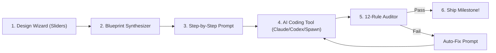

# Queen's Domain Architecture Engine

<p align="center">
  
</p>

<p align="center">
  <strong>Autonomous Vibe-Coding Platform & Modular Game Blueprint Synthesizer</strong><br>
  <em>Turn broad game concepts into ordered, hallucination-free AI prompts, audited against 12 architectural rules.</em>
</p>

<p align="center">
  <a href="https://github.com/orionopenwow/queens-domain/releases/tag/v1.0.0"></a>
  <a href="https://github.com/orionopenwow/queens-domain/releases/download/v1.0.0/QueensDomain.exe"></a>
  <a href="https://github.com/orionopenwow/queens-domain/releases/download/v1.0.0/QueensDomain-v1.0.0-windows-x64.zip"></a>
  
  
</p>

---

## 🎮 What is Queen's Domain?

**Vibe-coding a game fails when you ask an AI for "the whole game" at once.** Context windows saturate, platforms misconfigure, and generative models hallucinate game state logic.

**Queen's Domain** solves this fundamentally:
1. **Interactive Blueprint Synthesizer**: Answer questions using intuitive **sliders and toggle buttons** to configure your game's scope, platform, art style, and mechanics.
2. **Modular Step-by-Step Prompting**: The engine synthesizes a calibrated 9-to-50 step production plan. Each prompt contains strict context bounds, engine conventions, and modular acceptance criteria.
3. **Spawn.co Chrome Developer Mode Integration**: 1-click clipboard copy and browser launcher that opens your Spawn.co world directly inside **Google Chrome with DevTools pre-docked**.
4. **12-Rule Code Auditor**: Test the code generated by your AI models (Claude Code, ChatGPT Codex, Ollama, Gemini) against 12 strict production rules with automatic remediation prompts.
5. **PC Hardware Analyzer**: Evaluates local GPU VRAM and CPU limits against your target game engine and local LLMs with a 4-level color gauge.

---

## ⚡ Highlights & Key Features

### 🎛️ Sliders & Visual Controls (No More Walls of Text)
- **Project Scope Slider**: Slide between `Weekend Jam (~9 steps)`, `Prototype (~16 steps)`, `Indie Release (~25 steps)`, and `Commercial Steam Release (~38+ steps)`.
- **Hardware & Performance Targeter**: Instantly throttle performance targets from Retro Handhelds (Game Boy / NES) up to High-End Desktop PCs.
- **Difficulty & Pace Dials**: Calibrate gameplay cadence and difficulty dynamically.

### 🌐 Spawn.co Chrome DevMode Integration
- Click **"🚀 Spawn in Chrome Dev"** to copy the engineered step prompt to your clipboard and immediately launch the target world inside Google Chrome with `--auto-open-devtools-for-tabs` and `--start-maximized`.
- Test multi-agent wisps (1 to 8 parallel builders) directly from the console deck.

### 🎨 Isolated Asset Sheet Studio
- Inspect modular **Kenney CC0 public domain** asset sheets directly inside the console.
- **Sheet Inspector**: Preview 2D sprite sheets, 3D kits, and audio packs with format metadata and isolated path specs (`assets/<pack>/`).
- **Dynamic Context Injection**: Every imported asset pack is automatically declared inside your generated prompts, instructing the AI to use existing assets rather than creating placeholders.

### 🛡️ 12-Rule AI Code Auditor
- **State Decoupling**: Enforces strict separation between simulation state and render loops.
- **Memory & Allocation Bounds**: Blocks memory leaks in high-frequency update ticks.
- **Auto-Fix Generator**: Receive an instant, copy-paste prompt instructing the AI how to fix failing rules without regressing working code.

### 🚀 Dev Console Wizard & Autopilot
- **Invariant Test Suite**: 1-click execution of 100+ dependency-free checks verifying platforms, templates, and security boundaries.
- **Security Flaw Scanner**: Scans for path traversal, command injection, and origin spoofing.
- **Autopilot Milestone Sync**: Automatically runs tests, records git commits, and pushes concept updates to GitHub.
- **1-Click Release Builder**: Compiles `QueensDomain.exe` and packages distribution `.zip` archives.

---

## 💻 Supported Platforms & Engines

| Platform | Type | Language / Format | Output Style |
| :--- | :--- | :--- | :--- |
| **Spawn.co** | Cloud / Browser | TypeScript & Savi AI | Declarative Specs & Direct World Sync |
| **Unity** | Desktop / 3D / 2D | C# (.NET) | Complete MonoBehaviour Scripts |
| **Godot 4** | 2D / 3D / Cross-Platform | GDScript / C# | Node Trees & Modular Scripts |
| **Unreal Engine 5** | High-Fidelity 3D | Blueprints & C++ | Actor Components & Subsystems |
| **Phaser 3** | Web / HTML5 | TypeScript (Vite) | Scenes & Arcade Physics |
| **Three.js / Babylon** | Web 3D | TypeScript | Render Loop & World Systems |
| **Roblox Studio** | Multiplayer Web | Luau | ServerScriptService & ReplicatedStorage |
| **GameMaker** | 2D Pixel / Arcade | GML | Object Events & Room Creation |
| **Construct 3** | 2D Web | Event Sheets | Click-by-Click Event Actions |
| **Rosebud AI** | Web AI | Natural Language | Prompt Architectures |

---

## 🚀 Quick Start Guide

### Option 1: Standalone Windows App (Recommended)
1. Download **[`QueensDomain.exe`](https://github.com/orionopenwow/queens-domain/releases/download/v1.0.0/QueensDomain.exe)** or extract **[`QueensDomain-v1.0.0-windows-x64.zip`](https://github.com/orionopenwow/queens-domain/releases/download/v1.0.0/QueensDomain-v1.0.0-windows-x64.zip)**.
2. Double-click `QueensDomain.exe` (or `launch.bat`).
3. The app opens immediately in dedicated desktop mode!

### Option 2: From Source (Zero npm dependencies)
```bash
# Clone the repository
git clone https://github.com/orionopenwow/queens-domain.git QueensDomain
cd QueensDomain

# Launch the server (Requires Node 18+)
npm start

# Or run tests
npm test
```

Then navigate to `http://127.0.0.1:47831/` in your browser.

---

## 📖 How to Build a Game with Queen's Domain



1. **New Project**: Click **+ Create New Project** on the Projects tab.
2. **Sliders & Dials**: Use the sliders to select your game scope, target engine (e.g. Unity or Spawn.co), 2D/3D dimension, and art style.
3. **Step Roadmap**: Open your project to reveal the step roadmap.
4. **Copy & Prompt**: Click **📋 Copy Prompt** or **🚀 Spawn in Chrome Dev** to send the self-contained prompt to your coding tool.
5. **Audit Code**: Paste the generated code into the Auditor to verify memory management, state isolation, and engine hygiene. Pass all 12 rules, then advance to the next step!

---

## 📁 Repository Structure

```
QueensDomain/
├── QueensDomain.exe          # Compiled native Windows desktop launcher
├── launch.bat                # 1-click fallback batch launcher
├── package.json              # Zero-dependency npm manifests
├── README.md                 # Project documentation
│
├── app/                      # Front-end StarCraft-styled UI
│   ├── index.html            # Main application console & styles
│   ├── wizard.js             # 25-facet questionnaire & blueprint generator
│   ├── platforms.js          # Engine packs & code overrides
│   ├── assets.js             # Kenney CC0 asset catalog & matcher
│   ├── templates.js          # Built-in game templates (Souls, Stardew, Terraria)
│   └── fonts/                # Bundled offline web fonts (Rajdhani & ShareTechMono)
│
├── server/                   # Zero-dependency local Node.js engine
│   ├── server.js             # HTTP server, Chrome launcher, hardware analyzer
│   └── repo.js               # Git commit, push, and repository manager
│
├── scripts/                  # Developer utilities & automation
│   ├── build-exe.js          # Native C# compiler runner via csc.exe
│   ├── build-release.js      # Distribution packager & GitHub release publisher
│   ├── autopilot.js          # Automated milestone test-commit-push engine
│   └── dev-console-wizard.js # Pre-flight diagnostic & security scanner
│
├── tests/                    # Dependency-free automated test suite
│   ├── run.js                # Core test runner (100% pass verification)
│   └── repo.js               # Git & repository security tests
│
└── docs/                     # Architectural specifications
    ├── ARCHITECTURE.md       # Full system architecture
    ├── WIZARD.md             # Blueprint generation rules
    ├── MODELS.md             # AI provider and local hardware matrix
    └── ROADMAP.md            # Expansion facets roadmap
```

---

## 🔒 Privacy & Local Execution

- **100% Local**: The server listens only on `127.0.0.1` and strictly refuses foreign origins.
- **Zero Credentials Read**: Local tools (Claude Code, ChatGPT Codex, Ollama) use their own existing logins; Queen's Domain never reads credential or token files from other applications.
- **No Telemetry**: No user analytics or telemetry packets leave your machine.

---

## 📜 License & Credits

- **Engine Code**: MIT License. Open source and free for developers.
- **Asset Catalog**: CC0 1.0 Universal Public Domain by [Kenney.nl](https://kenney.nl/).
- **Presets Included**: *Queen's Domain* built-in ARPG blueprint (50 steps).
