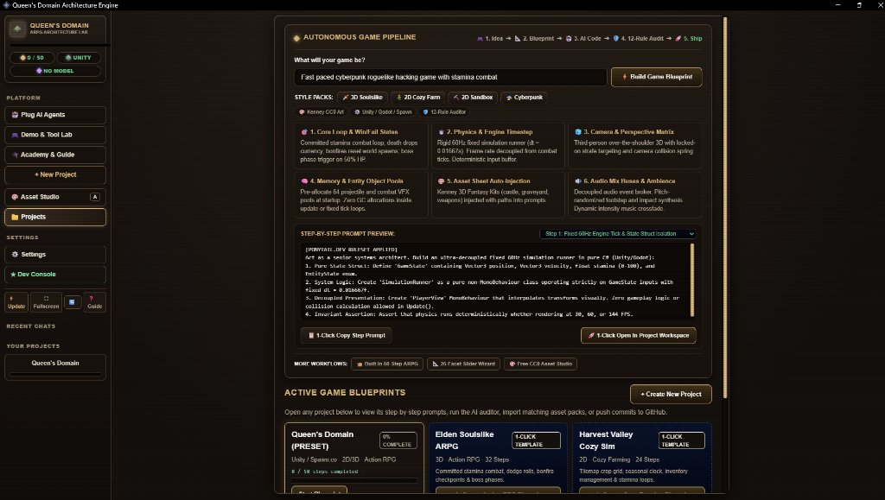
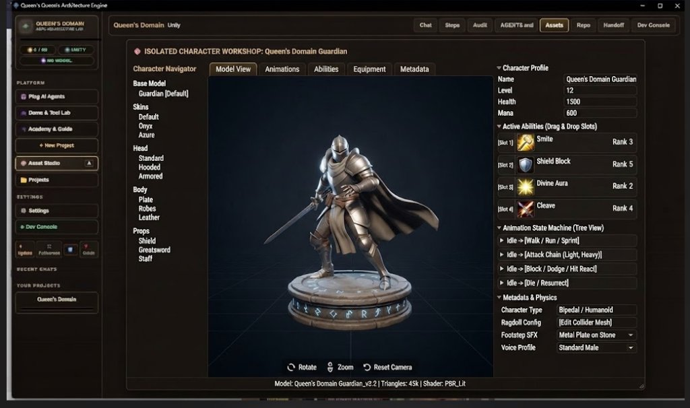
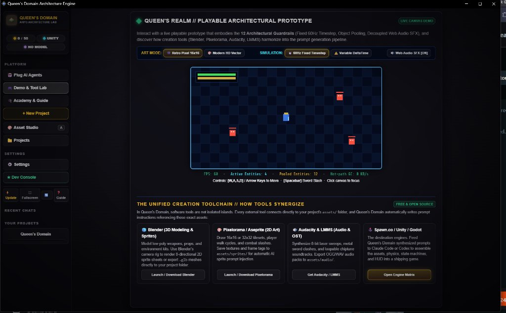
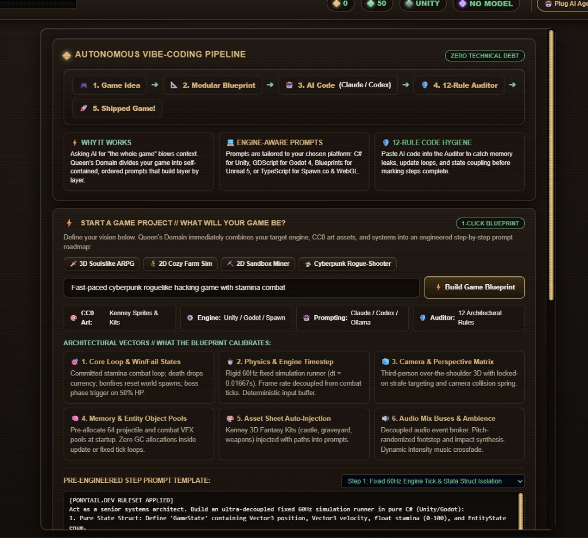
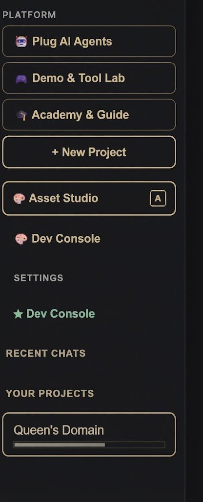

# Queen's Domain Architecture Engine

<p align="center">
  
</p>

<p align="center">
  <strong>Autonomous Vibe-Coding Platform, Modular Asset Synthesizer & AI Game Studio</strong><br>
  <em>Turn natural game ideas into modular, zero-debt AI agent prompts with pre-matched CC0 asset sheets, 60Hz deterministic architecture, and 1-click starter bundles.</em>
</p>

<p align="center">
  <a href="https://github.com/orionopenwow/queens-domain/releases/tag/v1.0.0"></a>
  <a href="https://github.com/orionopenwow/queens-domain/releases/download/v1.0.0/QueensDomain.exe"></a>
  <a href="https://github.com/orionopenwow/queens-domain/releases/download/v1.0.0/QueensDomain-v1.0.0-windows-x64.zip"></a>
  
  
</p>

---

## 🎮 What is Queen's Domain?

**Queen's Domain** is a zero-dependency, local-first game architecture studio and autonomous vibe-coding engine that turns plain-English game concepts into clean, production-ready games. Instead of overwhelming AI coding models by asking for "the whole game" at once—which causes hallucinations, memory leaks, and bloated boilerplate—Queen's Domain greets you with an elevated conversational interface, automatically curates matching CC0 2D/3D assets from its local database, and constructs a live, ever-evolving architectural prompt ready for autonomous agents like Claude Code, Cursor, Codex, and Ollama. It enforces strict 60Hz deterministic state isolation and object pooling, provides an isolated 3D character studio and playable canvas prototype, and packages complete starter bundles (`README.md`, `AGENTS.md`, `.cursorrules`, and assets) with 1-click export.

---

## 📸 Interface & Workflow Screenshots

### 1. Conversational Welcome & Autonomous Vibe-Coding Pipeline
*Type your vision or click an inspiration card to auto-configure game loops, physics timesteps, and engine parameters.*



---

### 2. Isolated 3D Character Workshop & Model Studio
*Inspect, rotate, and customize 3D meshes, skeleton hierarchies, ability loadouts, and state machines.*



---

### 3. Playable 60Hz Canvas Prototype & Unified Toolchain
*Test deterministic physics, object pooling, and Web Audio SFX live, and explore recommended software (Blender, Pixelorama, Audacity, Godot, Spawn).*



---

### 4. Architectural Vectors & Live Code Prompting
*Calibrate core loops, fixed timesteps, camera perspective matrices, and zero-GC memory pools with live prompt generation.*



---

### 5. Streamlined Minimalist Glassware Sidebar
*Single unified control column with platform navigation, settings, dev console, and GitHub update alerts.*



---

## ⚡ Core Systems & Features

### 💬 1. ChatGPT-Style Conversational Game Builder
* **Natural Language Input**: Type any game concept into the elevated welcome bar (e.g., *"Cozy farming life sim with seasonal clock and seed economy"*).
* **Inspiration Presets**: Instant 1-click calibration cards:
  * 🎨 **2D Pixel Art RPG**: 16x16 tiles, hero walk cycle, village NPCs.
  * 🗡️ **3D Low-Poly Souls**: Third-person camera, committed stamina combat, dark dungeon kit.
  * 🌾 **2D Cozy Farm Sim**: 15-minute daily clock, seed-to-harvest crop loops, tranquil acoustic audio.
  * ⛏️ **2D Sandbox Miner**: Destructible voxel slice, underground mining tiers, safehouse crafting.
  * 🛸 **Cyberpunk Roguelike**: Isometric neon hacking nodes, drone combat, twin-stick bullet hell.
  * 🧟 **Survival Horror**: Scarce ammo pools, flashlight raycasts, sanity meter, spatial audio.

### 📦 2. Curated Game Asset Sheet (Local CC0 Database)
Every game vision matches into a 6-slot modular asset sheet sourced from royalty-free public domain assets:
* **Slot 1 (Protagonist / Hero)**: *Queen's Domain Guardian 3D*, *Hero Knight 16x16*, *Cyber Mech*, *Forest Ranger*, *Skeleton Warrior*, *Tiny Town Farmer*.
* **Slot 2 (World & Tileset)**: *Kenney Castle Kit*, *Tiny Town Overworld*, *Space Station Modular Kit*, *Tiny Dungeon Crypt*, *Nature Wilderness*, *Pixel Industrial*.
* **Slot 3 (Weapons & Gear)**: *Medieval Weapons Pack*, *Pixel Roguelike Weaponry*, *Cyber Energy Blasters*, *Farming & Mining Tools*, *Arcane Staves*.
* **Slot 4 (UI & HUD Kit)**: *Retro RPG UI*, *Sci-Fi Hologram HUD*, *Minimalist Glassware*, *Pixel Adventure UI*, *Cozy Wooden Parchment*.
* **Slot 5 (Audio SFX & Ambience)**: *RPG Audio + Footsteps*, *8-Bit Chiptune Action*, *Cozy Acoustic Ambience*, *Cyberpunk Synth SFX*, *Creepy Horror SFX*.
* **Slot 6 (Visual Palette & Shaders)**: *16-Color Dawnbringer / PBR Lit*, *GameBoy 4-Color*, *PS1 Retro Dither & Vertex Snap*, *Neon Cyberpunk Bloom*, *Cel-Shaded Toon*.
* **Interactive `[🔁 Sub In / Out]` Drawer**: Swap any asset slot instantly. The selected paths automatically update inside the evolving code prompt.

### ⚡ 3. Fixed Bottom-Right Ever-Evolving Prompt Dock
* Floating glassware dock with live prompt generation that evolves as you tweak your game concept and assets.
* **Step Breakdown**: Switch between *Step 1: Fixed 60Hz Simulation*, *Step 2: Zero-GC Input Event Bus*, *Step 3: Object Pooling Subsystem*, *Step 4: FSM Combat & Visual Presentation*, or *Full Autonomous Master Blueprint*.
* **Controls**:
  * `📋 1-Click Copy`: Copies formatted code prompts to your clipboard.
  * `🤖 Send to Agent`: Copies the prompt and opens the Autonomous Agent Hub.
  * `📦 ZIP`: Exports the complete starter bundle directly to your browser.
  * `─ / ▢`: Minimizes into a discreet pill or expands back to full view.

### 🛠️ 4. Recommended Software Hub & 1-Click Starter Bundle (.ZIP)
* Direct download recommendations for the open-source creative toolchain:
  * 🎮 **Godot 4.3 / Unity 6**: Game Engine & Runtime
  * 🧊 **Blender 4.2**: 3D Modeling & Animation
  * 🎨 **Pixelorama / Aseprite**: 2D Pixel Art & Timeline
  * 🔊 **Audacity & LMMS**: Audio Synthesis & Chiptunes
* **1-Click Download Starter ZIP**: Native Windows PowerShell bundle generator creates a customized archive with:
  * `README.md`: Customized game vision & architectural invariants.
  * `AGENTS.md`: Autonomous agent boundaries and work crew specs.
  * `.cursorrules`: Zero-allocation hot paths and fixed-timestep rules.
  * `ROADMAP.md`: Step-by-step implementation milestones.
  * `ARCHITECTURE.md`: The 12 Architectural Hygiene Rules.
  * `ASSETS.md`: Active CC0 asset sheet and path mappings.

### 🤖 5. Autonomous AI Agent & GitHub Mastery Hub
Dedicated workspace educating developers on how to orchestrate autonomous coding agents without accumulating technical debt:
* 🟣 **Claude 3.7 Code**: Command-line agent workflow (`claude -p "..."`).
* ⚡ **Cursor & Windsurf**: Inline code completion guided by `.cursorrules`.
* 🟢 **OpenAI Codex CLI**: Direct repo-level script execution (`codex exec "..."`).
* 🦙 **Ollama Local Runner**: 100% offline, private coding agent with zero token cost.
* **5-Step GitHub Workflow**:
  1. `git init` or clone your repository.
  2. Drop `AGENTS.md` and `.cursorrules` in your project root.
  3. Feed Queen's Domain step prompts to your agent.
  4. Run Queen's Domain's 12-Rule AI Auditor before committing.
  5. Commit and push: `git commit -m "feat: complete step 1" && git push origin main`.

### 🛡️ 6. The 12 Architectural Hygiene Rules
1. **Single Source of Truth**: Simulation state lives in pure data structs (`GameState`), separate from rendering views.
2. **Fixed 60Hz Timestep**: Simulation tick is decoupled from rendering frame rates ($dt = 0.016667s$).
3. **Pre-Allocated Object Pools**: Projectiles and VFX entities are pooled at boot; zero runtime allocations.
4. **Zero-GC Hot Paths**: No heap allocations (`new`, LINQ, closures) inside `Update()` or physics loops.
5. **Deterministic Input Buffers**: Circular ring buffers record inputs for rollbacks and replay inspection.
6. **Decoupled Audio Broker**: Sound effects are dispatched through event delegates, preventing cyclic coupling.
7. **Strict State Transitions**: Finite state machines disallow invalid state transitions.
8. **Explicit Save Boundaries**: Disk saves serialize data structs without triggering world respawns.
9. **No Factory Bloat (7-Rung Ladder)**: Prefer native primitives and standard library over speculative wrappers.
10. **Hardware-Aware Throttling**: Automatically bounds draw calls and vertex counts to target specs.
11. **Pure Presentation Interpolation**: Visual meshes interpolate position from fixed state without modifying physics.
12. **Audit Verifiability**: Every module includes acceptance checks and invariant assertions.

---

## 🚀 Quick Start Guide

### Option 1: Standalone Windows App (Recommended)
1. Download **[`QueensDomain.exe`](https://github.com/orionopenwow/queens-domain/releases/download/v1.0.0/QueensDomain.exe)** or **[`QueensDomain-v1.0.0-windows-x64.zip`](https://github.com/orionopenwow/queens-domain/releases/download/v1.0.0/QueensDomain-v1.0.0-windows-x64.zip)**.
2. Double-click `QueensDomain.exe`.
3. The app opens immediately in dedicated desktop mode with zero configuration!

### Option 2: From Source (Zero External npm Dependencies)
```bash
# 1. Clone the repository
git clone https://github.com/orionopenwow/queens-domain.git QueensDomain
cd QueensDomain

# 2. Start the local server (Requires Node.js 18+)
npm start

# 3. Or run the dependency-free test suite
npm test
```
The browser or desktop window will launch automatically at `http://127.0.0.1:47831/`.

---

## 📁 Repository Structure

```
QueensDomain/
├── QueensDomain.exe          # Compiled native Windows desktop launcher (C# / .NET)
├── launch.bat                # 1-click fallback launcher
├── package.json              # Zero-dependency npm manifests
├── README.md                 # Project documentation & visual guide
│
├── app/                      # Front-end UI & Studio Viewers
│   ├── index.html            # Main application UI, ChatGPT welcome bar & prompt dock
│   ├── wizard.js             # 25-facet questionnaire & blueprint generator
│   ├── platforms.js          # Engine packs & code overrides (Unity, Godot, Spawn, Unreal)
│   ├── assets.js             # Kenney CC0 asset catalog & matcher
│   ├── templates.js          # Built-in game templates (Souls, Stardew, Terraria)
│   ├── presets/              # High-fidelity 3D model & asset textures
│   └── fonts/                # Bundled offline web fonts
│
├── server/                   # Zero-dependency local Node.js engine
│   ├── server.js             # HTTP server, zip bundler, update checker & agent connector
│   └── repo.js               # Git commit, push, and repository manager
│
├── scripts/                  # Developer utilities & automation
│   ├── build-exe.js          # Native C# compiler runner via csc.exe
│   ├── build-release.js      # Distribution packager & GitHub release publisher
│   ├── autopilot.js          # Automated milestone test-commit-push engine
│   └── dev-console-wizard.js # Pre-flight diagnostic & security scanner
│
├── tests/                    # Dependency-free automated test suite
│   ├── run.js                # Core test runner (100% pass verification)
│   └── repo.js               # Git & repository security tests
│
└── docs/                     # Architectural specifications & screenshots
    ├── screenshots/          # Embedded UI screenshots & workflows
    ├── ARCHITECTURE.md       # Full system architecture
    ├── WIZARD.md             # Blueprint generation rules
    ├── MODELS.md             # AI provider and local hardware matrix
    └── ROADMAP.md            # Expansion facets roadmap
```

---

## 🔒 Privacy & Local Execution

* **100% Local**: The server listens strictly on `127.0.0.1` and blocks all foreign origins.
* **Zero Credential Theft**: Local tools (Claude Code, ChatGPT Codex, Ollama) authenticate with their own official CLIs; Queen's Domain never reads external credential files.
* **No Telemetry**: Absolutely zero telemetry, analytics, or background tracking packets leave your computer.
* **Standard Library First**: Built strictly with native Node.js and standard platform tools without fragile dependency trees.

---

## 📜 License & Credits

* **Engine Code**: MIT License. Open source and free for developers.
* **Asset Catalog**: CC0 1.0 Universal Public Domain by [Kenney.nl](https://kenney.nl/).
* **Architectural Philosophy**: Based on the *Ponytail Method* (simplest solution that actually works, zero over-engineering).
